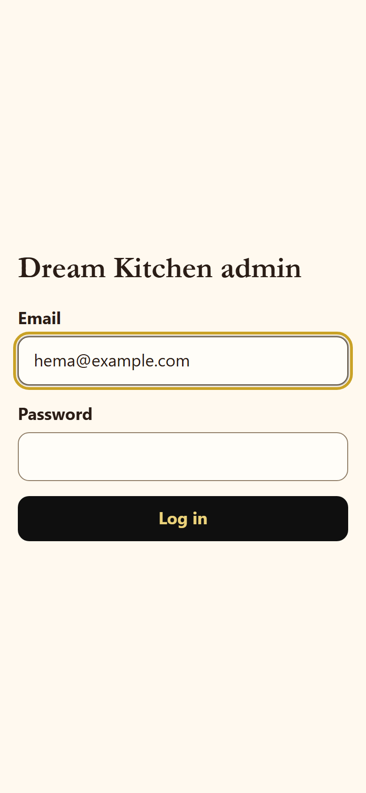
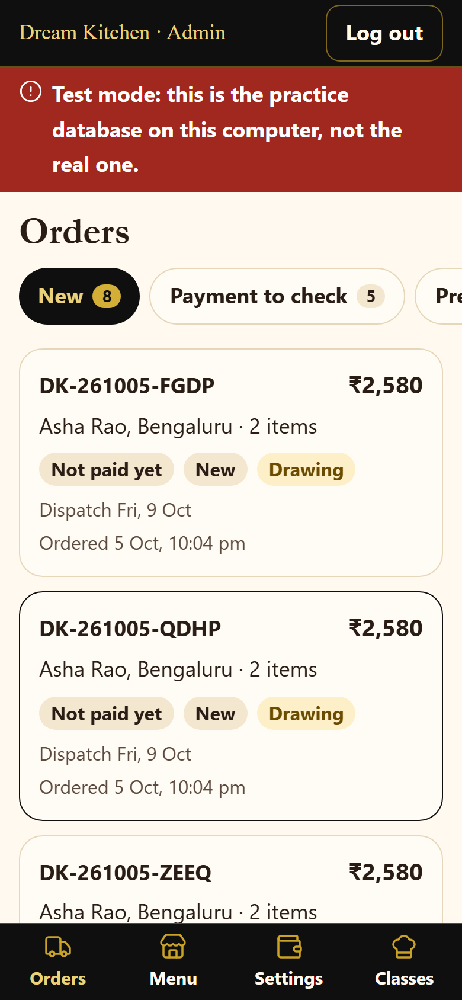
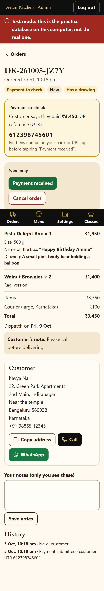
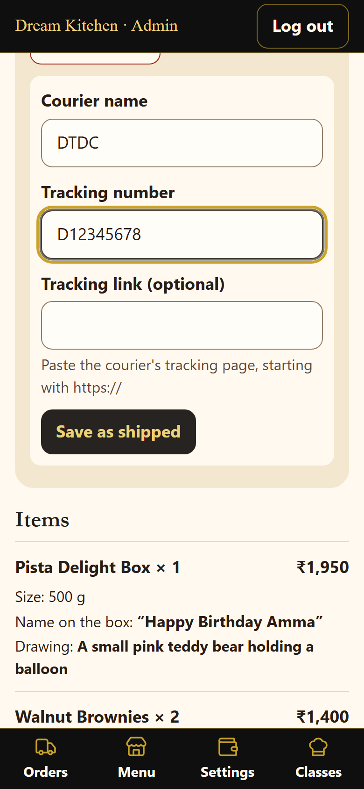
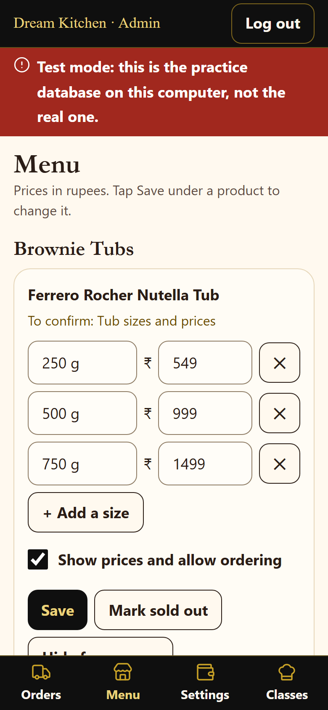
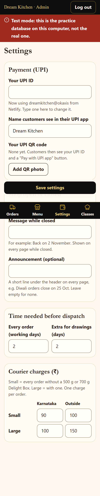
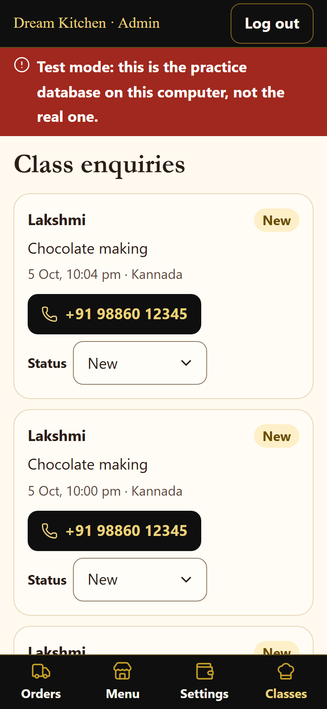

# Your admin: a short guide for Hema

Open **your-website/admin** on your phone and log in with your email and password.
Tip: in Chrome, tap ⋮ → **Add to Home screen**, so the admin opens like an app.

At the bottom are four buttons: **Orders**, **Menu**, **Settings**, **Classes**.
A **red bar** at the top means something needs you (for example, your UPI ID is missing).
"Saved" appears only after the website has really saved your change. If something goes wrong,
it says so in plain words; just try again.

---

## Orders

The tabs sort your orders:

| Tab | What it means | What you do |
|---|---|---|
| **New** | Ordered, not paid yet | Wait for the payment (or call the customer) |
| **Payment to check** | The customer says they paid and gave the UPI number | Check your bank app (below) |
| **Preparing** | Paid | Make it |
| **Shipped** | With the courier | Mark "Delivered" when it arrives |
| **Done** | Delivered or cancelled | Nothing |

Each card shows the order number, the name and town, the total, the payment and the dispatch
date. A yellow **Drawing** label means the order has a drawing. Tap a card to open it.

## One order

**Checking a payment.** The yellow box shows the amount and the customer's **12-digit UPI
reference**. Open your bank or UPI app, find a payment with the same number and amount, then
tap the green **Payment received**. If you can't find it, call the customer (the **Call** button
is further down) before you tap anything. The customer's screenshot, if they added one, is there too.

**Then, one tap per step:**
- **Preparing**: you have started making it.
- **Shipped**: type the courier name (e.g. DTDC) and the tracking number, and paste the courier's
  tracking link if you have one. Tap **Save as shipped**. The customer gets an email (if they gave
  one) and sees the tracking number on Track Order.
- **Delivered**: when it has arrived.
- **Cancel order**: type why (the customer sees it). Use it for test orders too.

**Everything else on the page:**
- **Items**, with every choice: size, ragi, the **name on the box** (in big letters, copy it
  exactly), the **drawing description**, and the **reference photo** (tap to open it large).
- **Customer**: the address, **Copy address** (paste it into the courier's form), **Call** and
  **WhatsApp**.
- **Your notes**: only you see them (e.g. "Called, will collect"). Tap **Save notes**.
- **History**: every change, with who did it and when.

## Menu

Each product has its own card:
- Change a price and tap **Save**. New orders use it at once; carts already open show
  "Some prices have been updated".
- **Mark sold out** / **Back in stock**: customers see "Sold out" and can't order it.
- **Hide from menu** / **Show on menu**: takes it off the website completely.
- **Back to original**: undoes your changes to that product.
- **Brownie Tubs**: when you decide the tub sizes and prices, type each size (e.g. "250 g") and
  its price, **+ Add a size** for more, tick **Show prices and allow ordering**, then **Save**.
  The Dream Cake Tub says "Price coming soon" until you do this.

## Settings

- **Your UPI ID** (like `dreamkitchen@okaxis`) and the name customers see. Without it, customers
  see "Payments open soon" and can't pay.
- **Your UPI QR code**: take a screenshot of your QR in your UPI app and add it here.
- **Taking orders**: untick to pause orders (holidays, too busy). Write a "Message while closed",
  for example "Back on 2 November". It shows on every page.
- **Announcement**: one short line on every page (e.g. "Diwali orders close on 25 Oct").
  Leave it empty for none.
- **Time needed before dispatch**: working days for every order, and the extra days for drawings.
- **Courier charges**: Small (any order without a 500 g or 700 g Delight Box) and Large, for
  Karnataka and outside. One charge per order.

Tap **Save settings** at the bottom and wait for "Saved".

## Classes

Enquiries from the Classes page, newest first. Tap the number to call, then set the status to
**Contacted** or **Closed**. You also get an email for each new enquiry.

---

## Emails you receive

- **New order DK-…**: every new order, with all the details and a link to it in the admin.
- **Payment to check: DK-…**: when a customer enters their UPI number.
- **Class enquiry: name**: every new class enquiry.

## If something is wrong

- Forgot your password: ask whoever set up the website (it is reset in Supabase).
- A red bar you don't understand: take a screenshot and send it to whoever set up the website.
- A customer says they paid but you can't find it: don't tap "Payment received"; call them.
