# Your admin: a short guide for Hema

Your admin is where you see orders and class bookings, and change prices, photos and settings.
It works on your phone.

**Open it:** your-website**/admin** (for example `dreamkitchenblr.in/admin`; until the new web address is
ready, `dreamkitcheno1.netlify.app/admin`). Your login: **dreamkitchen.web01@gmail.com** and your password.
**Tip:** in Chrome tap **⋮** → **Add to Home screen**. Then it opens like an app.

**Want to practise first?** your-website**/admin/demo** is the same admin with made-up orders.
Tap anything you like there: nothing is real and nothing is saved.

A few things to know:
- **"Saved"** in green means it is really saved on the website. If something goes wrong, it says
  so in plain words. Just try again.
- The website shows your changes **within a minute**.
- A **red bar** at the top means something needs attention. Tap it to go to the right place.
- After **30 days** without opening the admin, it asks you to log in again. That keeps your shop
  safe if your phone is lost.

---

## 1. Logging in

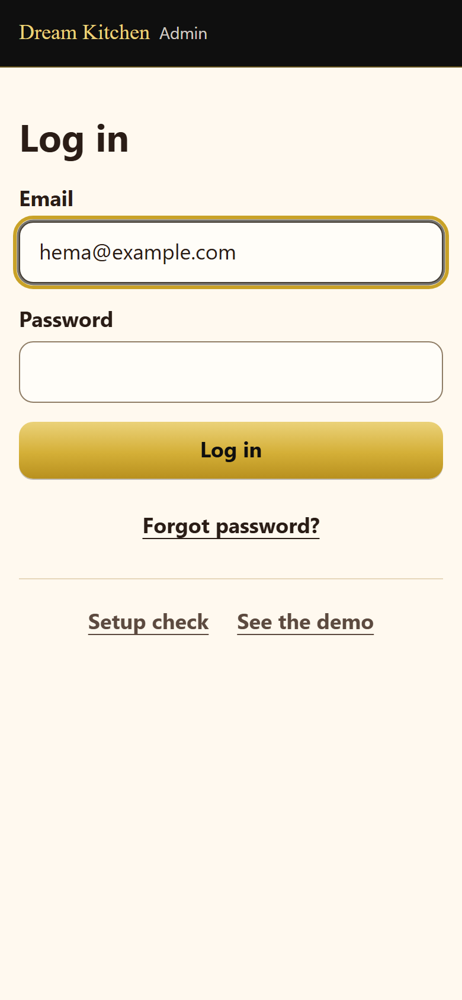

Type your email and your password, then tap **Log in**.

**Forgot your password?** Tap **Forgot password?**, type your email, tap **Send me the link**.
Open the email on your phone, tap the link, and type a new password two times.

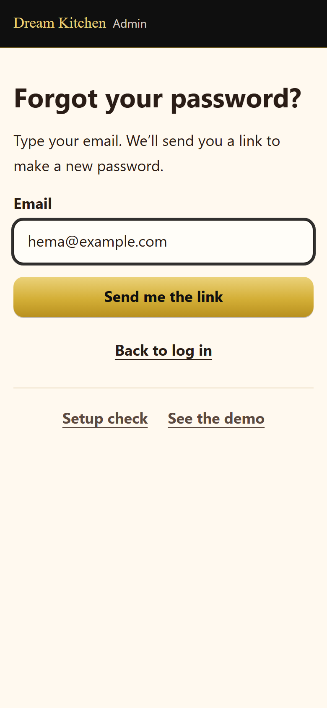

**Log out:** tap **Log out** at the top (or **More** → **Log out**).

---

## 2. Home: your day at a glance

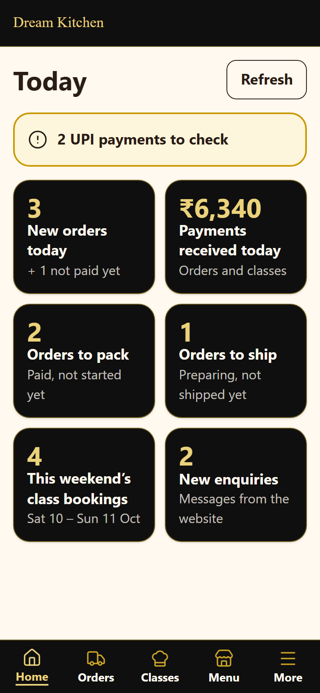

At the bottom are five buttons: **Home**, **Orders**, **Classes**, **Menu**, **More**.

Home shows big cards. **Tap a card** to see the list behind it:

| Card | What it means |
|---|---|
| **New orders today** | Orders that came in today (paid, or with a UPI payment to check) |
| **Payments received today** | Money paid today, for orders and classes |
| **Orders to pack** | Paid, and you haven't started them yet |
| **Orders to ship** | You're making them; mark "Shipped" when they leave |
| **This weekend's class bookings** | Who is coming this Saturday and Sunday |
| **New enquiries** | Messages from the website |

A yellow box **"UPI payments to check"** appears only if a customer paid you by UPI and you
need to check it in your bank app.

---

## 3. Orders

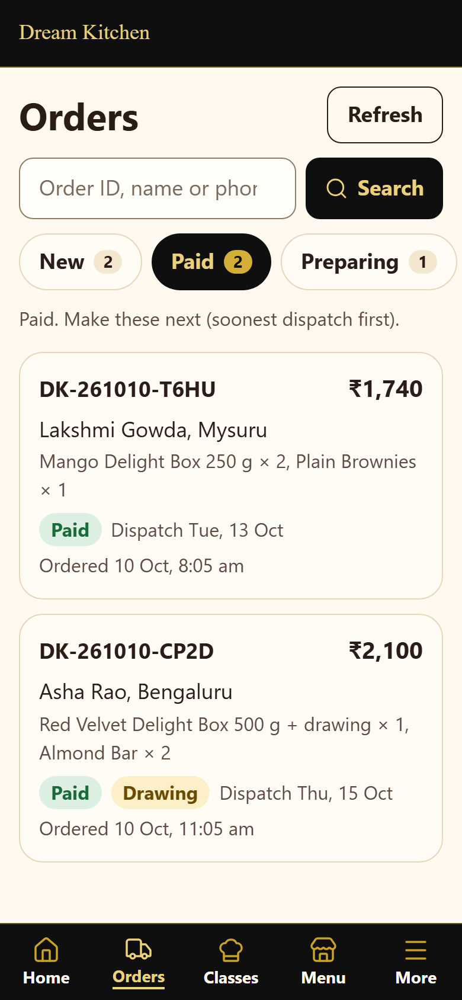

The tabs sort your orders: **New** (not paid yet) · **Paid** (make these next) · **Preparing** ·
**Shipped** · **Delivered** · **Cancelled**. "Paid" and "Preparing" show the soonest dispatch
date first.

**Find an order:** type the order number, the customer's name or their phone number in the
search box and tap **Search**.

Each card shows the order number, the name and town, what to make, the total, and the dispatch
date. A yellow **Drawing** label means the order has a drawing. **Tap a card** to open it.

### One order

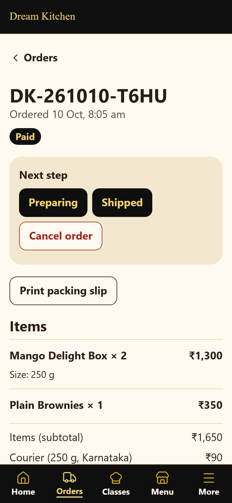

At the top: the order number and its status. Then **Next step**: the buttons for what you can do
now. Below:
- **Items**, with every choice: the size, ragi, the **name on the box** (copy it exactly), the
  **drawing description** and the customer's **reference photo** (tap it to see it big).
- **Payment**: how they paid. For online payments you see the **Razorpay payment ID** (you need
  it if you ever look the payment up in Razorpay).
- **Customer**: the address.

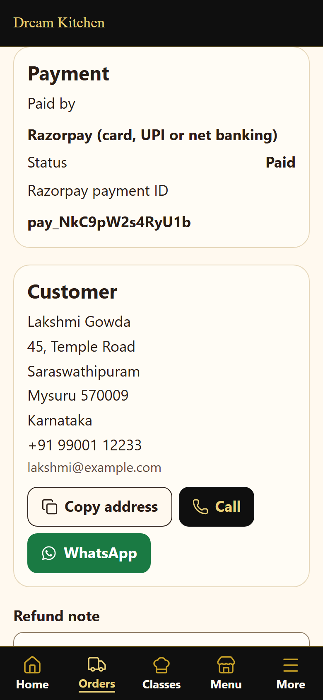

- **Copy address**: copies the whole address, ready to paste into the courier's form.
- **Call** the customer, or **WhatsApp** them. The WhatsApp message already has the order number
  in it.

### Moving an order along (one tap each)

1. **Preparing**: tap it when you start making the order.
2. **Shipped**: type the **courier name** (for example DTDC) and the **tracking number**. Paste the
   courier's tracking link too if you have one. Tap **Save as shipped**.

   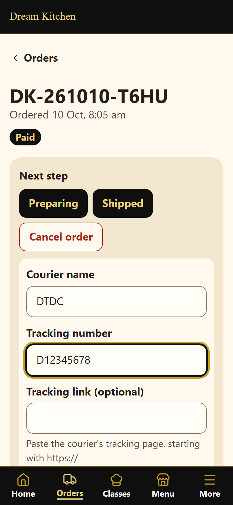

3. **Delivered**: tap it when it has arrived.

Every tap is saved in the order's **History**, the customer sees it on **Track Order**, and
**they get an email** about it (if they gave their email).

**Cancel order:** tap it, type why (the customer sees this), then **Cancel this order**.
If they had paid, give the money back in the **Razorpay dashboard** (Payments → the payment →
Refund), then write what you did in **Refund note** and tap **Save refund note**.

**UPI payments** (only while Razorpay isn't set up): a yellow box shows the customer's 12-digit
UPI number. Find the same number in your bank app. Found it? Tap **Payment received**. Not found?
WhatsApp the customer first. Don't tap anything yet.

**Your notes**: only you see these (for example "Called, will collect").

### Packing slip

On the order, tap **Print packing slip**. You get a clean page with the address in big letters
and everything in the parcel (no prices). Tap **Print**, or take a screenshot.

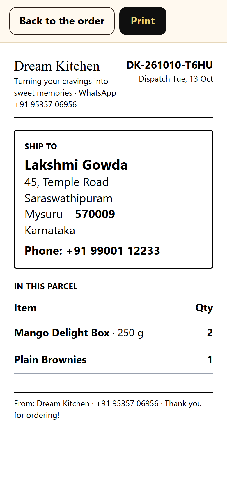

---

## 4. Menu: prices, sold out, photos, new products

Every product has its own card.

**Change a price:** type the new price and tap **Save**. Wait for the green **Saved**.

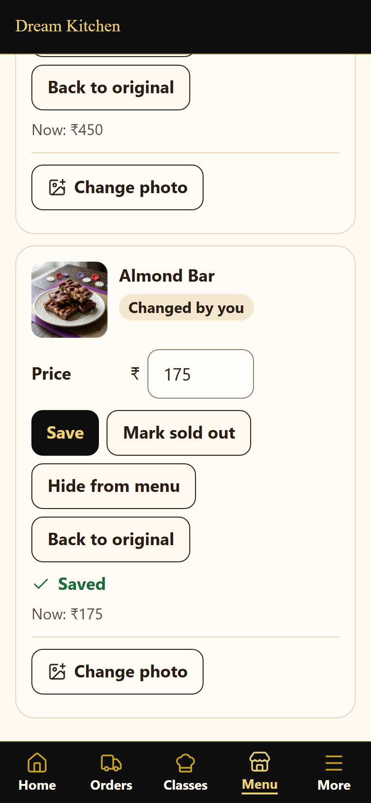

**Sold out:** tap **Mark sold out**. Customers see "Sold out" and can't order it. When you have it
again, tap **Back in stock**.

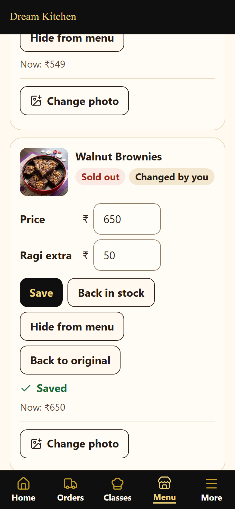

- **Hide from menu** / **Show on menu**: takes a product off the website completely, or brings it
  back.
- **Back to original**: undoes your changes (prices, name, description) for that product.
- **Change photo** (the big black button on each product): take a photo or pick one from your
  gallery. The admin makes it the right size by itself; wait for **"Photo saved. It is on the
  website now."** A square photo with the product in the middle looks best. If it says in red that
  the photo was not uploaded, nothing has changed on the website: just try again.
  **Use the old photo** puts the previous one back (**Remove photo** on products you added).

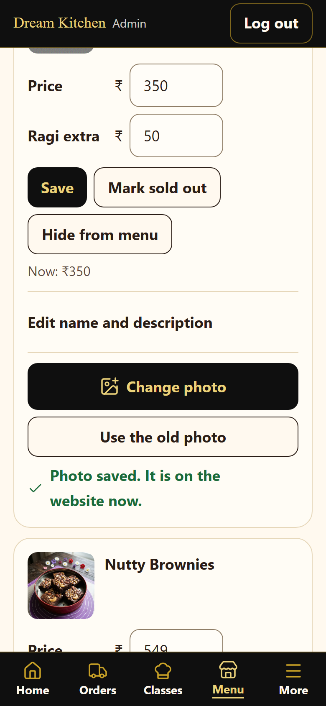
- **Brownie Tubs** (for example the **Dream Cake Tub**): type each size (for example "500 g") and
  its price, tap **+ Add a size** for more, tick **Show prices and allow ordering**, then **Save**.
  Until then the website says "Price coming soon".
- **Edit name and description** (under each product): change the name or the short description,
  in English and (if you like) Kannada, then tap **Save name and description**. Leave the Kannada
  empty and Kannada readers see your English.

**Add a new product:** tap **+ Add a new product** at the top of Menu.
1. **Where on the menu**: Brownie Tubs, Delight Boxes, Brownies or Chocolates.
2. **Name in English** (needed), **Name in Kannada** (optional), a short **description** (optional).
3. **Price**: **One price**, or **Different sizes**: type each size (for example "250 g") and its price;
   **+ Add a size** for more.
4. **Courier charge**: pick the parcel it is most like (small, medium or large). The customer pays
   that courier charge.
5. **Photo** (optional): take one or pick one from your gallery.
6. Tap **Add to menu**. It is on the website within a minute, with an **Added by you** label here.

There is no Delete button, on purpose: old orders must keep their product. To take something off
the website, tap **Hide from menu**.

---

## 5. Classes

At the top: **Bookings** · **Who's coming** · **Weekends** · **Fees & times**.

**Bookings:** every booking, newest first. Choose a **weekend** and a **time slot** to see only
those. Tap a booking to see it, **WhatsApp** the person, or **Cancel** it (with a reason).

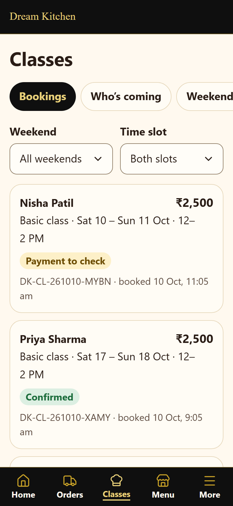

**Who's coming:** the list of names for each slot on a weekend, and how many seats are taken.
**Print this list** if you like.

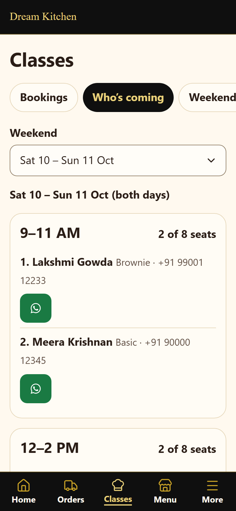

**Weekends:** close a weekend (a holiday) or one time slot (full). Customers can't book closed
ones; bookings already made stay. Tap **Open** to open it again.

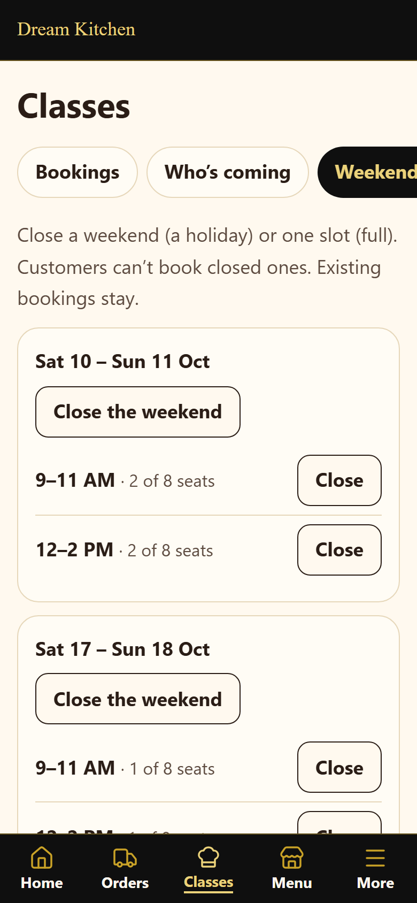

**Fees & times:** change the class fees, the two time slots, and the **seats per slot** (leave it
empty for no limit; then the website shows no seat count). Tap **Save class settings**.

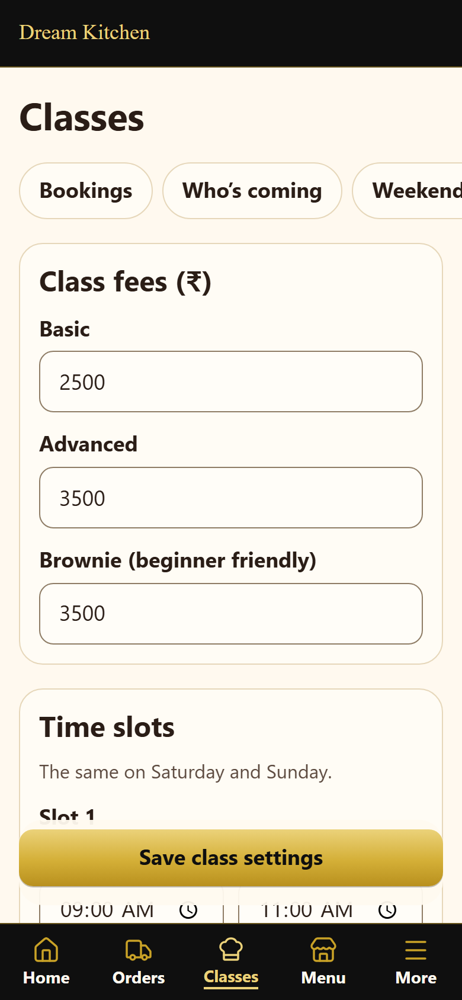

Customers pay online when they book, so bookings arrive **Confirmed**. (While Razorpay isn't set up,
UPI bookings show "Payment to check": check the UPI number in your bank app, then tap **Payment
received**.)

---

## 6. More: Settings, Enquiries, Reports

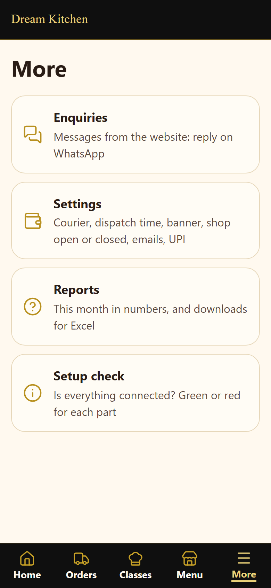

### Settings

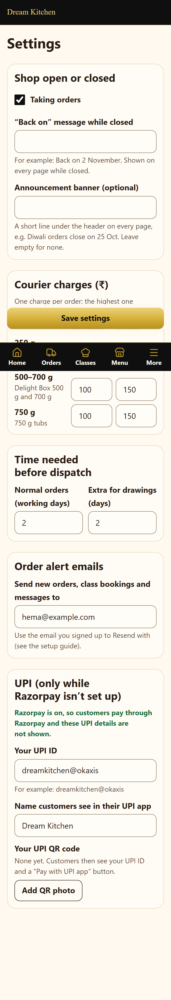

- **Shop open or closed**: untick **Taking orders** to pause orders (a holiday, too busy). Write a
  **"Back on" message** like "Back on 2 November". It shows on every page.
- **Announcement banner**: one short line on every page (for example "Diwali orders close on 25
  Oct"). Leave it empty for none.
- **Courier charges**: for **250 g**, **500–700 g** (Delight Boxes) and **750 g** (tubs), inside
  Karnataka and outside. One charge per order.
- **Time needed before dispatch**: working days for normal orders, and the extra days for drawings.
- **Order alert emails**: where your "new order", "new class booking" and "new message" emails go.
- **UPI**: only used while Razorpay isn't set up.

Tap **Save settings** at the bottom and wait for **Saved**.

### Enquiries

Messages from the website (class questions and the Contact page). Tap **Reply on WhatsApp** (the
first line is typed for you), then **Mark handled**.

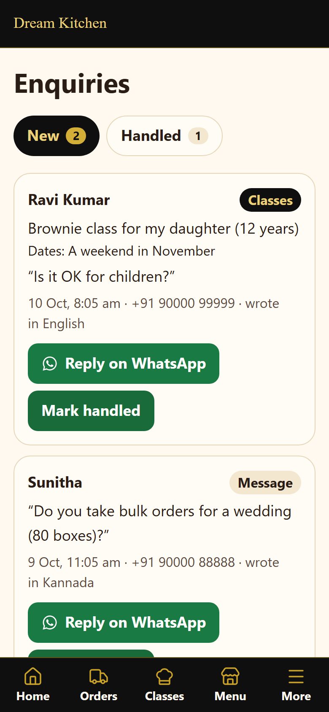

### Reports

This month in numbers: paid orders, money, class bookings, and your **top 5 products**. Tap
**‹** and **›** for other months. Below, pick two dates and tap **Download orders** or **Download
class bookings**: you get a file for Excel or Google Sheets.

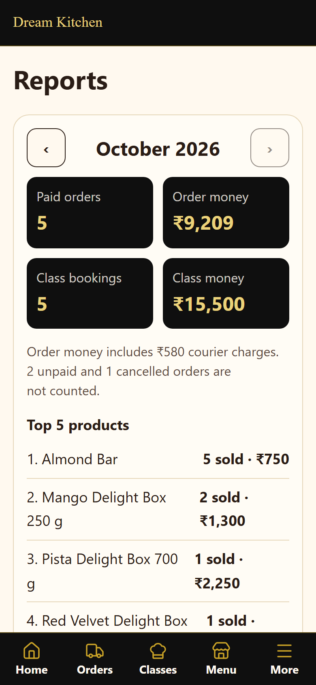

---

## Emails you get

- **New paid order DK-…**: a new order, paid. Everything is in the email, with a link to it.
- **New class booking DK-CL-…**: someone booked a class.
- **Message: name** / **Class enquiry: name**: a message from the website.
- **New order, payment to check** / **Class booking, payment to check**: only while Razorpay isn't
  set up: a customer paid by UPI and you need to check it.

## If something is wrong

- **Forgot your password:** tap **Forgot password?** on the log in page.
- **A red bar or a message you don't understand:** take a screenshot and send it to whoever set up
  the website.
- **A customer says they paid but the order says "Not paid yet":** online payments usually show
  within a few minutes. If it still says "Not paid yet" after an hour, look for the payment in
  the Razorpay dashboard before doing anything.
